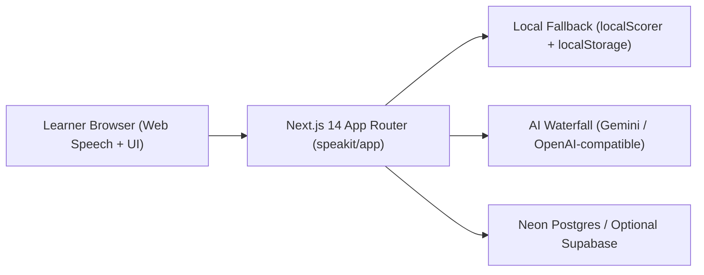

# SpeakIT — IT Workplace English Speaking Practice

SpeakIT is an interactive web application built to help Vietnamese IT students and junior developers practice workplace English speaking through AI-evaluated engineering scenarios, vocabulary drills, and multiplayer technical speaking games. Designed for the IUH & BCN Club applied research study, the platform works zero-login out of the box and stays functional even when optional AI keys or microphone permissions are unavailable.

> [!NOTE]
> Try the live production app at [speakit-bcn.vercel.app](https://speakit-bcn.vercel.app).

## Main features

- **Workplace Scenario Practice (`/practice/[scenario]`)**: Multi-turn IT roleplay conversations (standups, outage handoffs, code reviews, client calls) with browser speech recognition (`SpeechRecognition`), typed-text fallback, anti-Vietnamese/gibberish scoring guards, and instant structured feedback (`40% Từ khóa`, `30% Đầy đủ`, `30% Ngữ pháp`).
- **IT Arena Hub (`/arena`)**: Four interactive technical communication modes (*Outage At 3AM* co-op incident room, *Code Review Duel*, *Explain It Like I'm 5* taboo challenge, *Syntax Bomb* tech word chain) alongside *Bug Buster* speed drills, Web Audio arcade SFX, and IT-Coin payouts.
- **IT Vocabulary & Study Roadmap (`/vocabulary`, `/placement`, `/progress`)**: Curated and clustered IT terminology with IPA phonetics, audio playback (`msedge-tts` / `google-tts-api` / `speechSynthesis`), quick quizzes, and personalized skill tracking.
- **Gamification, Leaderboard & Shop (`/leaderboard`, `/shop`, `/profile`)**: Public guest rankings, streaks, IT-Coin economy, and live try-on profile cosmetics (avatar frames, profile themes, cursor trails with touch support, rank FX, nameplates, victory finishers).
- **Research Portal & Admin Studio (`/research`, `/admin`)**: Curated tech/benchmark articles, live telemetry export (CSV/JSON), AI content/vocab import auto-repair, bulk selection + 2-step delete confirmation (`delete` keyword gate), and a first-time interactive Spotlight Product Tour (`FeatureGuideDock`).

## Architecture



## Requirements

- **Node.js**: `18+` (tested on Node `22.x`) and `npm`
- **Database (optional for local trial)**: Neon Postgres (`DATABASE_URL`) or optional Supabase keys (`NEXT_PUBLIC_SUPABASE_URL`, `NEXT_PUBLIC_SUPABASE_ANON_KEY`); the app gracefully falls back to `localStorage` when unconfigured.
- **AI & TTS (optional)**: `GEMINI_API_KEY` (or user-provided key in `/settings`); falls back to deterministic keyword scoring and browser `speechSynthesis` when omitted.

## Installation and running

```bash
git clone https://github.com/quanbt4567/nghien-cuu-tieng-anh-sv-cntt.git
cd nghien-cuu-tieng-anh-sv-cntt
npm --prefix speakit install
cp speakit/.env.example speakit/.env.local
npm run dev
```

Open `http://localhost:3000` in Google Chrome, Microsoft Edge, or Safari to start practicing.

To run the automated test suite and type/production checks:

```bash
npm --prefix speakit test
npm run build
```

> [!WARNING]
> Never commit real API keys, admin passcodes, or database connection strings to `.env.example`, `README.md`, or any tracked file. Store local secrets only in untracked `.env.local`.

## Usage

| Route | Purpose |
| --- | --- |
| `/` | Landing overview and quick start into placement or scenarios |
| `/placement` | Quick level check to recommend a tailored IT speaking track |
| `/scenarios` & `/practice/[scenario]` | Record voice answers (or type) and receive keyword + grammar feedback |
| `/arena` | Play *Outage At 3AM*, *Code Review Duel*, *Explain It Like I'm 5*, and *Syntax Bomb* |
| `/vocabulary` | Study clustered IT terms, listen to pronunciation, and take quick quizzes |
| `/shop` & `/leaderboard` | Preview and unlock cosmetics with earned IT-Coins |
| `/admin` | Manage scenarios, vocabulary JSON/CSV import/export, cosmetics, research articles, and analytics |

When first visiting any feature page, an interactive Spotlight Product Tour highlights controls step by step; you can replay it anytime using the floating **Hướng dẫn** button.

## Folder structure

- `speakit/app/`: Next.js App Router pages and API route handlers (`api/score`, `api/party`, `api/arena`, `api/admin`, `api/tts`, `api/research`)
- `speakit/components/`: Modular UI components for practice, Arena games, cosmetics live try-on, product tours, and the `/admin` studio
- `speakit/lib/`: Scoring engines (`localScorer.ts`, `ai-waterfall.ts`), Neon/storage adapters, TTS players, gamification, and bulk-delete utilities
- `speakit/data/`: Built-in workplace scenarios, EF EPI benchmarks, and Bug Buster datasets
- `speakit/tests/`: Node `node:test` unit and API route contract suites
- [speakit/package.json](speakit/package.json): Application dependencies and scripts
- [speakit/.env.example](speakit/.env.example): Template of optional environment variables
- [speakit/specs/001-workplace-speaking-practice/plan.md](speakit/specs/001-workplace-speaking-practice/plan.md): Architecture specification and design token rules

## Roadmap

- [x] Core multi-turn IT speaking practice with Web Speech STT & local scoring fallback
- [x] Hybrid AI grading waterfall with anti-Vietnamese/teencode/gibberish zero-score guards
- [x] 4 multiplayer/bot Arena speaking games & Web Audio SFX
- [x] Cosmetic shop with live try-on sandbox, touch cursor trails, and public leaderboard
- [x] Interactive first-time Spotlight Product Tour & `/admin` bulk delete with 2-step `delete` confirmation
- [ ] Export anonymized semester dataset for final IUH & BCN Club research publication

## Getting help & contributing

1. Check existing issues or open a new ticket in the repository's **Issues** tab with reproduction steps and browser details.
2. To contribute changes, create a feature branch, run `npm --prefix speakit test` and `npm run build`, and open a Pull Request against the default branch.

## Team members

- Minh Quân (`quanbt4567`) – Project developer & maintainer (IUH & BCN Club Research Project)

## License

Academic research project for IUH & BCN Club. No separate `LICENSE` file is currently included in this repository.
