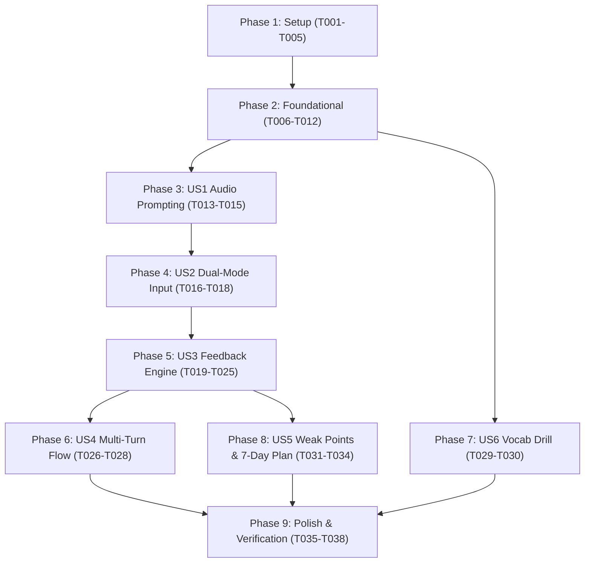

# Tasks: Workplace English Speaking Practice (SpeakIT)

**Input**: Design documents from `specs/001-workplace-speaking-practice/` (`spec.md`, `plan.md`, `research.md`, `data-model.md`, `contracts/`, `quickstart.md`)  
**Prerequisites**: Project constitution (`.specify/memory/constitution.md`)  
**Target Project Directory**: `speakit/`

---

## Format: `[ID] [P?] [Story] Description`
- **[P]**: Can run in parallel (different files, no conflicting dependencies)
- **[Story]**: User story identifier (US1, US2, US3, US4, US5, US6)
- File paths are explicitly specified for every task.

---

## Phase 1: Setup & Environment

**Purpose**: Initialize Next.js 14+ App Router project, design system tokens, and baseline tooling.

- [x] T001 Initialize Next.js 14+ with TypeScript, Tailwind CSS, and App Router structure in `speakit/package.json` and `speakit/tsconfig.json`
- [x] T002 [P] Install dependencies (`lucide-react`, `clsx`, `tailwind-merge`) in `speakit/package.json` (excluding decorative animation libraries per Principle VIII)
- [x] T003 [P] Configure Tailwind tokens in `speakit/tailwind.config.ts` adhering strictly to Constitution Principle VI: locked tokens (warm paper `#FAF6EF`, ink `#1A1714`, recording-red accent `#E5484D`, `Be Vietnam Pro` + `JetBrains Mono`, 16px radius, hard shadow `4px 4px 0 #1A1714`)
- [x] T004 [P] Configure root styling and font imports in `speakit/app/globals.css` and `speakit/app/layout.tsx` using `Be Vietnam Pro` and `JetBrains Mono` with full Vietnamese diacritics support
- [x] T005 [P] Create `.env.example` in `speakit/` with template variables for Supabase and local dev Gemini key, ensuring `.env.local` is ignored in `.gitignore`

---

## Phase 2: Foundational (Core Data & Resilient Infrastructure)

**Purpose**: Establish static data, storage abstraction, and fallback scoring before implementing UI stories.

**⚠️ CRITICAL**: Foundational modules must be complete before user story UI integration.

- [x] T006 Create verified EF EPI 2025 constants in `speakit/data/efEpiData.ts` (Vietnam 500, rank 64/123, rank 7/25 Asia, Speaking 461 weakest, adults 18+ nationwide per Constitution Principle I)
- [x] T007 Create complete scenario and vocabulary content in `speakit/data/scenarios.ts` (6 scenarios × 3 turns = 18 turns with `questionEN`, `keywords[]`, `sampleAnswerEN`, `hintVI`, plus 12 IT vocabulary terms)
- [x] T008 [P] Define core TypeScript domain interfaces in `speakit/lib/types.ts` (`Scenario`, `ScenarioTurn`, `ScoreResponse`, `PracticeAttempt`, `WeakPoint`, `UserSettings`)
- [x] T009 [P] Implement deterministic local keyword regex matcher and heuristic scoring in `speakit/lib/localScorer.ts` (Formula: 40% keywords + 30% completeness + 30% grammar rules)
- [x] T010 [P] Implement Web Speech API wrappers in `speakit/lib/speech.ts` for SpeechSynthesis (rates: 0.8x, 1.0x, 1.2x) and SpeechRecognition (`lang="en-US"`) with feature detection
- [x] T011 [P] Implement resilient storage abstraction in `speakit/lib/storage/index.ts`, `speakit/lib/storage/localStorageAdapter.ts`, and `speakit/lib/storage/supabaseAdapter.ts` ensuring transparent fallback to `localStorage` when Supabase is not configured
- [x] T012 [P] Create navigation bar and footer in `speakit/components/layout/Navbar.tsx` and `speakit/components/layout/Footer.tsx`

**Checkpoint**: Foundation ready — all data, storage adapters, speech helpers, and scoring utilities ready.

---

## Phase 3: User Story 1 - Scenario Audio Prompting & Explorer (Priority: P1) 🎯 MVP Core

**Goal**: Students can browse 6 workplace scenarios and listen to the spoken question prompts with Vietnamese hints.  
**Independent Test**: Navigate to `/`, view the 6 scenario cards with EF EPI 2025 evidence, click into `/practice/daily-standup`, and verify speech synthesis reads the English question aloud at chosen speeds.

- [x] T013 [P] [US1] Create EF EPI 2025 evidence banner and scenario setlist layout on Home page `speakit/app/page.tsx`
- [x] T014 [P] [US1] Build speech synthesis player component in `speakit/components/audio/AudioPromptPlayer.tsx` with rate toggles (0.8x, 1.0x, 1.2x) and replay button
- [x] T015 [US1] Build scenario practice shell in `speakit/app/practice/[scenario]/page.tsx` rendering active turn question, audio player, keywords preview, and Vietnamese hint (`hintVI`)

**Checkpoint**: User Story 1 functional — students can pick any scenario and hear spoken prompts with hints.

---

## Phase 4: User Story 2 - Dual-Mode Input with Resilient Fallback (Priority: P1)

**Goal**: Students can speak their answer via microphone in Chrome, with automatic fallback to typed text if mic is blocked or denied.  
**Independent Test**: Click mic button to record and see transcript; block microphone permissions and verify instant inline textarea fallback appears automatically.

- [x] T016 [P] [US2] Build signature microphone button component in `speakit/components/audio/MicButton.tsx` featuring the prominent circular button with active multi-ring pulsing wave listening animation
- [x] T017 [P] [US2] Build automatic typed fallback component in `speakit/components/audio/FallbackTextInput.tsx` with informative Vietnamese guidance when mic access is denied
- [x] T018 [US2] Integrate dual-mode input in `speakit/app/practice/[scenario]/page.tsx` connecting `MicButton` transcript streaming and `FallbackTextInput` with seamless tab/toggle controls

**Checkpoint**: User Story 2 functional — speech input and typed fallback both produce editable student responses.

---

## Phase 5: User Story 3 - Immediate Multi-Dimensional Feedback Engine (Priority: P1)

**Goal**: Submitting an answer produces 0–100 score, keyword badges, Vietnamese grammar feedback, better sentence, and honest pronunciation disclaimer.  
**Independent Test**: Submit an answer; observe score bar, used/missed keyword pills, grammar explanation in Vietnamese, and "AI mode off" banner when no key is set.

- [x] T019 [P] [US3] Build Gemini API integration client in `speakit/lib/gemini.ts` enforcing strict JSON schema and role-play system prompt
- [x] T020 [US3] Implement scoring API endpoint in `speakit/app/api/score/route.ts` handling hybrid evaluation (Gemini AI mode vs. local keyword scoring fallback)
- [x] T021 [P] [US3] Build animated score meter in `speakit/components/feedback/ScoreMeter.tsx` displaying overall score (0–100) and metric breakdown
- [x] T022 [P] [US3] Build keyword badge component in `speakit/components/feedback/KeywordBadges.tsx` rendering used vs missed keyword pills
- [x] T023 [P] [US3] Build "AI mode off" warning banner in `speakit/components/feedback/AiModeBanner.tsx`
- [x] T024 [US3] Build evaluation feedback card in `speakit/components/feedback/FeedbackCard.tsx` presenting grammar corrections in Vietnamese, "Better Sentence", and honest pronunciation note (`estimated from transcript`)
- [x] T025 [US3] Connect evaluation pipeline in `speakit/app/practice/[scenario]/page.tsx` saving attempt via `storageAdapter` upon scoring completion

**Checkpoint**: User Story 3 functional — end-to-end evaluation works in both AI mode and offline local mode!

---

## Phase 6: User Story 4 - Contextual Multi-Turn Conversation (Priority: P2)

**Goal**: The AI asks contextual follow-up questions across the 3 scenario turns based on previous answers, progressing to a completion summary.  
**Independent Test**: Complete Turn 1, verify Turn 2 prompt adapts to user's answer (or falls back to Turn 2 static question in offline mode); complete all 3 turns to see final summary.

- [x] T026 [US4] Update `speakit/app/api/score/route.ts` to process conversation history and generate dynamic `nextQuestion` in AI mode
- [x] T027 [US4] Implement multi-turn state manager in `speakit/app/practice/[scenario]/page.tsx` managing progression through Turn 1, Turn 2, and Turn 3
- [x] T028 [US4] Build 3-turn completion summary modal in `speakit/components/feedback/ScenarioSummary.tsx` with plain CSS completion state (16px card, hard offset shadow, aggregate score) without decorative confetti per Principles VI & VIII

**Checkpoint**: User Story 4 functional — full 3-turn dialogue loop with contextual progression.

---

## Phase 7: User Story 6 - High-Yield IT Vocabulary Drill (Priority: P2)

**Goal**: Dedicated vocabulary drill page for 12 IT workplace terms with audio pronunciation and workplace example sentences.  
**Independent Test**: Navigate to `/vocabulary`, verify all 12 terms are displayed, click audio speaker to hear pronunciation, and read example sentences.

- [x] T029 [P] [US6] Build vocabulary card component in `speakit/components/vocabulary/VocabCard.tsx` with phonetic guide, audio pronunciation button, and Vietnamese definition
- [x] T030 [US6] Create Vocabulary drill page in `speakit/app/vocabulary/page.tsx` rendering the 12 curated IT terms with filter and audio playback

**Checkpoint**: User Story 6 functional — students can practice key technical terms independently.

---

## Phase 8: User Story 5 - Weak-Point Tracking & Adaptive 7-Day Plan (Priority: P3)

**Goal**: Aggregate missed keywords and grammar errors to prioritize them in an adaptive 7-day study plan; manage settings.  
**Independent Test**: Intentionally miss keywords in practice, verify they appear as top priorities on `/progress` and the 7-day plan on `/`; test Gemini key on `/settings`.

- [x] T031 [P] [US5] Build 7-day adaptive plan generator utility in `speakit/lib/planGenerator.ts` prioritizing weak keywords and missed turns
- [x] T032 [P] [US5] Build 7-day plan component in `speakit/components/progress/SevenDayPlan.tsx` displayed on Home page
- [x] T033 [US5] Build progress and analytics page in `speakit/app/progress/page.tsx` showing per-scenario best scores, total turns, streak, and weak points list
- [x] T034 [US5] Build settings page in `speakit/app/settings/page.tsx` with Gemini API key input, connection test button, speech rate defaults, and "Reset Progress" with Vietnamese confirmation modal

**Checkpoint**: User Story 5 functional — persistent learning loop with adaptive spaced review and client-side settings.

---

## Phase 9: Polish & Cross-Cutting Verification

**Purpose**: Enforce quality standards, verify constitutional constraints, and validate build integrity.

- [x] T035 [P] Audit all UI text to ensure 100% Vietnamese error messages and toasts with zero unhandled crashes or unwrap failures
- [x] T036 [P] Verify anti-generic design compliance: warm paper `#FAF6EF`, ink `#1A1714`, recording-red accent `#E5484D`, `Be Vietnam Pro` (display + body) + `JetBrains Mono`, 16px cards, pill buttons, hard offset shadow `4px 4px 0 #1A1714`, zero forbidden styles
- [x] T037 Execute Quickstart validation scenarios A through E from `specs/001-workplace-speaking-practice/quickstart.md`
- [x] T038 Execute `npm run build` in `speakit/` to verify zero TypeScript errors and successful production compilation

---

## Dependencies & Execution Order

---

## Parallel Execution Opportunities

- **Phase 1**: T002, T003, T004, T005 can all run in parallel.
- **Phase 2**: T008, T009, T010, T011, T012 can all be implemented in parallel once T006 and T007 exist.
- **Phase 3 & Phase 7**: US1 (Scenarios) and US6 (Vocabulary) can be developed concurrently after Phase 2.
- **Phase 5**: UI components T021 (ScoreMeter), T022 (KeywordBadges), T023 (AiModeBanner), T024 (FeedbackCard) can be built in parallel.
- **Phase 8**: T031, T032, T033, T034 can be developed in parallel once storage adapters are ready.

---

## Implementation Strategy: MVP First

1. **Step 1 (Foundation & Setup)**: Complete Phase 1 and Phase 2.
2. **Step 2 (MVP Increment)**: Complete Phase 3 (US1), Phase 4 (US2), and Phase 5 (US3).
   - *Result*: End-to-end working turn in Chrome (TTS prompt $\rightarrow$ mic or typed input $\rightarrow$ score + feedback + offline fallback). This fulfills the user's primary success criteria.
3. **Step 3 (Conversational Expansion)**: Complete Phase 6 (US4) for multi-turn progression.
4. **Step 4 (Learning Enhancement)**: Complete Phase 7 (US6) for Vocabulary and Phase 8 (US5) for 7-Day Plan and Settings.
5. **Step 5 (Final Gate)**: Complete Phase 9 for build and constitutional verification.

